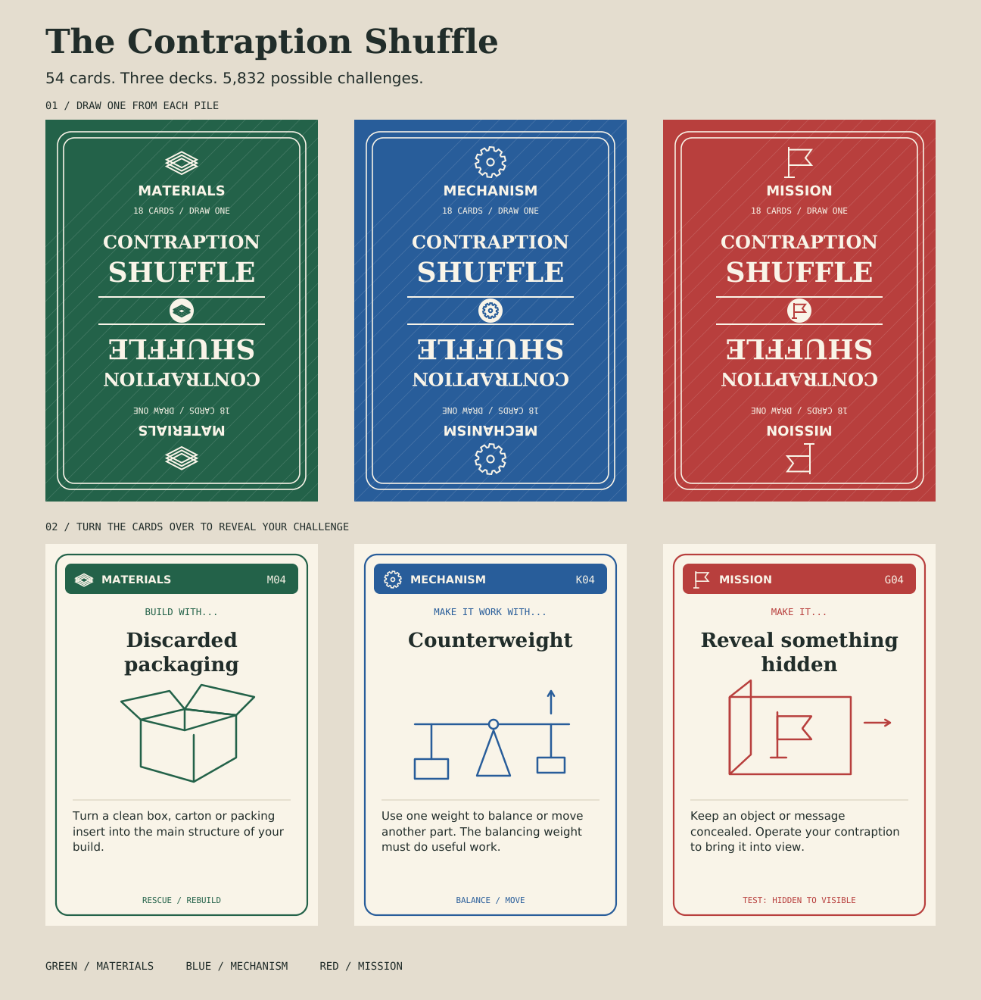

# The Contraption Shuffle

Draw one card from each of three piles to get a maker challenge. The **Materials** card tells you what to build with, the **Mechanism** card names a working part, and the **Mission** card gives it a job.

**Discarded packaging + Counterweight + Reveal something hidden.** Can you make a cereal-box theater whose curtain rises when you drop a coin into a paper cup?

[Print the cards](cards/Contraption-Shuffle-Home-Print.pdf) · [Read the rules](cards/Contraption-Shuffle-Rules.pdf) · [Download the print-shop pack](downloads/Contraption-Shuffle-Print-Pack.zip) · [Download The Game Crafter edition](downloads/Contraption-Shuffle-Game-Crafter-Common-Back.zip) · [Build a case](#build-a-case)



## Play at the workbench

For the original edition, sort the 54 cards by the symbols on their backs. For the common-back edition, sort by the category labels on the faces. Shuffle each pile separately and place it face down. Draw one of each. Use the material as a main ingredient and make the mechanism do something that helps accomplish the mission. Everyday supplies like tape and fasteners are fair game. A working model counts. If a draw stalls, keep the two cards you like and redraw the third.

| Pile | Back | Cards | Question |
| --- | --- | ---: | --- |
| Materials | Green · stacked sheets | 18 | What can I build with? |
| Mechanism | Blue · gear | 18 | What makes it work? |
| Mission | Red · flag | 18 | What should it do? |

The physical deck gives you 5,832 possible challenges. The rules are on a separate sheet so all 54 cards stay in play.

## Print the cards

**At home.** The [home-print PDF](cards/Contraption-Shuffle-Home-Print.pdf) makes the whole deck on six US Letter sheets. Print at **100% / actual size**, double-sided, flipping on the **long edge**. Each odd page has nine backs. The following even page has their matching faces. Print pages 1–2 first, hold the sheet up to the light to check alignment, then print the remaining pairs. Cut on the grid to get 2.5 × 3.5 inch cards.

**At The Game Crafter.** The [common-back upload pack](downloads/Contraption-Shuffle-Game-Crafter-Common-Back.zip) contains 54 individual poker faces, one reversible back for the entire deck, and outside artwork for the 54-card Poker Tuck Box. This edition also supports a mixed draw. Shuffle all the cards together, reveal the first of each category, and set duplicates aside. The [upload instructions](cards/print-shop/the-game-crafter/README.md) and [one-page rules](cards/print-shop/the-game-crafter/rules/Contraption-Shuffle-Common-Back-Rules.pdf) are included in the pack.

**At DriveThruCards.** Choose US Poker (2.5 × 3.5 inches) and upload the [54-card deck PDF](cards/print-shop/drivethrucards/Contraption-Shuffle-DriveThruCards-Deck.pdf). Its 108 pages alternate each category back with its matching face. For the custom box, select the 54-card poker tuckbox and upload the [tuckbox PDF](cards/print-shop/drivethrucards/Contraption-Shuffle-DriveThruCards-Tuckbox.pdf) separately.

**At a print shop.** The [complete print pack](downloads/Contraption-Shuffle-Print-Pack.zip) contains the PDFs, 300 dpi PNGs, front-to-back manifest and editable artwork generator. Choose the file arrangement your printer uses.

| Upload workflow | Files |
| --- | --- |
| Alternating back and face | [108-page PDF, back first](cards/print-shop/Cards-Back-Then-Face-Bleed.pdf) |
| Separate fronts and backs | [54 faces](cards/print-shop/Card-Fronts-Bleed.pdf) and [3 category backs](cards/print-shop/Card-Backs-Bleed.pdf). Use each back for its matching 18 faces. |
| Individual images | [300 dpi PNGs](cards/print-shop/300dpi/) and [card manifest](cards/print-shop/Card-Manifest.csv) |

The shop artwork includes ⅛ inch of bleed on every side. The 2.75 × 3.75 inch artwork trims to the same poker size as the home edition.

## Build a case

Both designs hold the three 18-card piles in separate bays, on their long edges. From the marked front to the back, load Materials, Mechanism, then Mission.

### 3D-printed case

[Download the full case kit](downloads/Contraption-Shuffle-Case-v1.0.zip) · [Base STL](cases/3d-printed/Base.stl) · [Lid STL](cases/3d-printed/Lid.stl) · [Print guide](cases/3d-printed/Print-guide.txt)

Print one base and one lid in millimetres at 100%. The STLs are oriented for support-free printing. Each bay is designed for an unsleeved pile up to 9 mm thick. Measure your thickest pile if you laminate your cards. The cap lifts straight off, and the end tracks accept an optional elastic band for carrying. The closed case measures 99.5 × 44.2 × 70.1 mm. To resize it, edit the [CadQuery model](cases/3d-printed/model.py) or use the [base](cases/3d-printed/Base.step) and [lid](cases/3d-printed/Lid.step) STEP solids.

### Laser-cut case

[Cutting SVG](cases/laser-cut/files/Contraption-Shuffle-Laser-Case.svg) · [Full-scale cutting PDF](cases/laser-cut/files/Contraption-Shuffle-Laser-Case.pdf) · [Assembly guide and parts map](cases/laser-cut/files/Contraption-Shuffle-Laser-Case-Assembly.pdf) · [Case preview](cases/laser-cut/files/Contraption-Shuffle-Laser-Case-Preview.png)

The tray and lift-off cover fit on one **300 × 220 mm** sheet of **3 mm plywood**. Use either cutting file at 100%. Cut the QF slot and QT tongue first to check the fit on your stock. The paths already compensate for a 0.15 mm full kerf, so start with zero additional offset. Engrave black first, cut blue interior slots next, and cut red outer profiles last. Dry-fit the tray and cover separately before gluing. The [design and drawing source](cases/laser-cut/work/) is included for adjustments.

## Play in a browser

The [browser edition](shuffle/) has 50 cards in each pile, for 125,000 combinations in Wild mode. Workshop mode filters for compatible draws. Pin a card to keep it, add a twist, or share a link that reproduces the same draw.

To run the browser edition locally, clone or download this repository. From the repository root, start a static server.

```sh
python3 -m http.server 8000
```

Open [localhost:8000/shuffle/](http://localhost:8000/shuffle/). To run the deck, draw and sharing checks with Node.js, use `node tests/shuffle.test.cjs`.

A workshop project from [Michael B. Parks](https://michaelbparks.com/).
